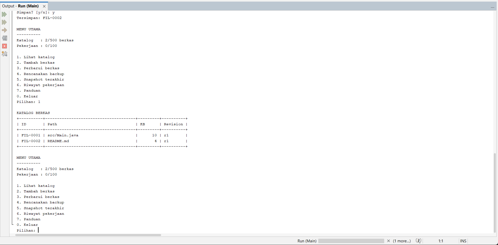
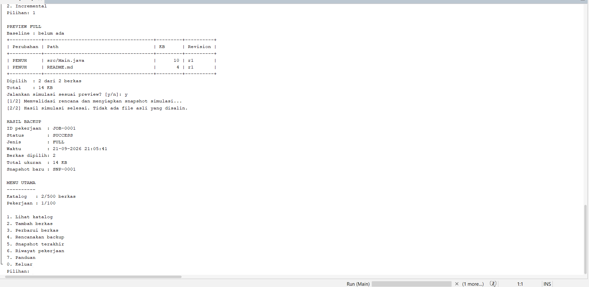
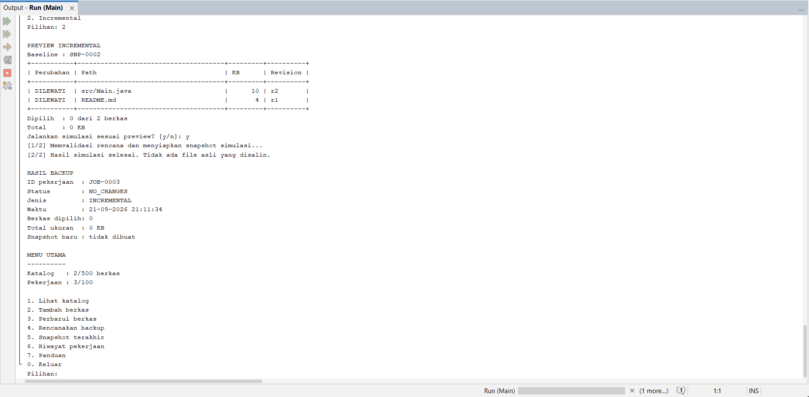
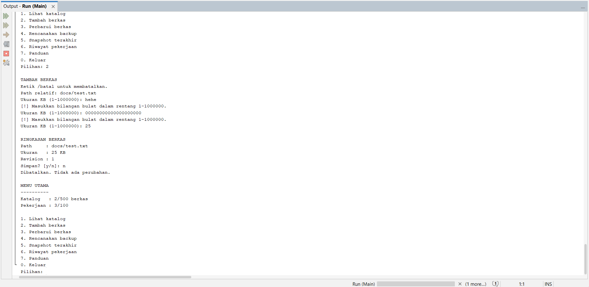

<div align="center">

# ArsipDelta

**Simulasi Pengelolaan Backup Penuh dan Incremental Berkas Proyek Berbasis Java CLI**

`JAVA 26` · `MAVEN` · `CLI` · `PEMROGRAMAN BERORIENTASI OBJEK`

Katalog berkas → preview perubahan → konfirmasi → snapshot & riwayat

[Mulai menjalankan](#03-menjalankan-aplikasi) · [Inheritance & PBO](#06-hierarki-class-dan-pbo) · [Pengujian](#09-pengujian)

</div>

---

> **Tentang aplikasi**  
> ArsipDelta memperlihatkan perbedaan full dan incremental melalui katalog berkas simulasi. Semua data berada dalam memori; aplikasi tidak membuat salinan file asli.

## Navigasi

| Memahami proyek | Menjalankan aplikasi | Memahami implementasi |
| :--- | :--- | :--- |
| [01 · Identitas](#01-identitas) | [03 · Menjalankan](#03-menjalankan-aplikasi) | [06 · Inheritance & PBO](#06-hierarki-class-dan-pbo) |
| [02 · Studi kasus](#02-studi-kasus) | [04 · Menu & demonstrasi](#04-menu-dan-contoh-penggunaan) | [07 · Struktur class](#07-tanggung-jawab-dan-struktur) |
| [05 · Aturan backup](#05-aturan-data-dan-backup) | [08 · Validasi input](#08-validasi-dan-ketahanan-lokal) | [09 · Pengujian](#09-pengujian) |

## 01 Identitas

| Identitas | Keterangan |
| :--- | :--- |
| **Nama** | **Muhammad Aulia Rahman** |
| **NIM** | **2509116096** |
| Mata kuliah | Pemrograman Berorientasi Objek |
| Jenis tugas | Individu |

---

## 02 Studi kasus

Operator mengelola katalog berkas proyek dan menentukan berkas yang perlu dibackup. Full memilih seluruh katalog, sedangkan incremental memilih berkas baru atau berbeda revision dari backup terakhir yang berhasil. ArsipDelta memperlihatkan preview, meminta konfirmasi, lalu menghasilkan snapshot dan riwayat simulasi.

Seluruh data berada dalam memori. Angka ukuran adalah metadata simulasi, bukan alokasi isi berkas. Aplikasi tidak membaca, menyalin, atau menghapus file pengguna. Tidak ada database, GUI, restore, compression, cloud, scheduler, authentication, atau networking pada aplikasi. Maven memerlukan akses unduhan plugin saat build pertama.

---

## 03 Menjalankan aplikasi

### Lingkungan

| Komponen | Versi / ketentuan |
| :--- | :--- |
| IDE | Apache NetBeans IDE 31 |
| Java | JDK 26, tanpa fitur preview; lingkungan pengembangan OpenJDK 26.0.2 |
| Build | Apache Maven 3.9.16 |
| Git | 2.55.0.windows.5 |
| Encoding | Source dan input/output UTF-8 |
| Dependency aplikasi | Tidak ada dependency eksternal |

### Melalui NetBeans

1. Ekstrak proyek jika berasal dari ZIP.
2. Pilih **File > Open Project**, lalu folder ArsipDelta yang berisi `pom.xml`.
3. Pastikan Java platform proyek menggunakan JDK 26. Maven default JDK juga perlu JDK 26.
4. Jalankan **Clean and Build**. Build pertama mungkin mengunduh plugin Maven.
5. Jalankan **Run Project**. Jika diminta main class, pilih `arsipdelta.Main`.
6. Masukkan jawaban melalui input konsol yang disediakan NetBeans. Jika panel IDE tidak mendukung interaksi dengan baik, jalankan JAR melalui terminal.

Proyek tidak membawa Maven Wrapper; pengaturan prefer-wrapper tetap dapat aktif dan Maven bundled digunakan bila tidak ada wrapper.

### Melalui terminal

Dari root proyek, dengan `java` dan `mvn` tersedia di PATH:

```text
java -version
mvn -version
mvn clean package
java -jar target/arsipdelta-1.0.0.jar
```

Maven bundled NetBeans tidak otomatis tersedia sebagai perintah `mvn` di terminal. Gunakan terminal dengan PATH yang sesuai atau jalankan build melalui IDE. `JAVA_HOME` harus menunjuk direktori JDK, bukan subfolder bin.

Windows juga dapat memakai `run.cmd` setelah build. Untuk pemeriksaan mandiri tanpa unduhan library test, jalankan `./verify.ps1` dari PowerShell setelah `JAVA_HOME` diatur ke JDK 26. Script menggunakan kebijakan eksekusi yang berlaku pada komputer; tidak mengubah kebijakan sistem.

---

## 04 Menu dan contoh penggunaan

| Menu | Fungsi |
| --- | --- |
| 1 | Tampilkan katalog, 15 baris per halaman |
| 2 | Tambahkan berkas baru |
| 3 | Catat revisi berkas yang sudah ada |
| 4 | Preview dan eksekusi full/incremental |
| 5 | Tampilkan snapshot terakhir |
| 6 | Riwayat dan detail pekerjaan |
| 7 | Panduan singkat |
| 0 | Konfirmasi keluar dan kehilangan data sesi |

### Skenario demonstrasi

1. Tambah `src/Main.java` ukuran 10 KB, konfirmasi y: ID `FIL-0001`, revision 1.
2. Tambah `README.md` ukuran 4 KB.
3. Jalankan full: dua berkas, total 14 KB, `JOB-0001`, `SNP-0001`.
4. Perbarui `FIL-0001` dengan ukuran 10 KB, konfirmasi: revision 2 meskipun ukuran tetap.
5. Jalankan incremental: hanya Main.java dipilih, total 10 KB, snapshot baru.
6. Jalankan incremental lagi: `NO_CHANGES`, tanpa snapshot baru.
7. Tambah berkas lain; incremental berikutnya hanya memilih berkas baru tersebut.

`/batal` membatalkan formulir. Input salah mengulang kolom yang sama. Saat pagination, n menghentikan tampilan halaman berikutnya, bukan mengeksekusi atau membatalkan backup; konfirmasi eksekusi selalu ditanyakan terpisah.

---

## 05 Aturan data dan backup

- ID otomatis: `FIL-0001`, `JOB-0001`, `SNP-0001`. Counter per jenis terpisah, empat digit minimum, mulai ulang pada sesi baru.
- Revision satu-satunya penanda perubahan isi. ID baru berarti BARU; ID sama dengan revision berbeda berarti BERUBAH; revision sama berarti DILEWATI.
- Path dan ID berkas tidak berubah. Operasi update mengganti objek immutable dan menaikkan revision.
- Full memilih semua berkas. Incremental membutuhkan snapshot dari **backup terakhir SUCCESS**, bukan selalu full terakhir.
- Snapshot memuat kondisi lengkap katalog. Setelah incremental SUCCESS, baseline maju ke kondisi terkini.
- `NO_CHANGES` dicatat sebagai hasil pekerjaan, tetapi tidak membuat snapshot.
- Preview menyimpan versi katalog dan ID baseline. Rencana usang atau bukan rencana aktif ditolak.
- Hasil dan snapshot disiapkan dahulu; commit dilakukan dengan mengganti satu objek state service.
- Pembatalan/penolakan tidak mengubah baseline atau riwayat sukses dan tidak memakai ID pekerjaan.
- Tidak ada jaminan pemulihan saat proses dihentikan atau kehabisan memori; data memang hanya in-memory.

---

## 06 Hierarki class dan PBO

```text
BackupJob (abstract)
  +-- FullBackupJob
  +-- IncrementalBackupJob

Main -> ConsoleUI -> CatalogMenu / BackupMenu
CatalogService memiliki koleksi FileRecord
BackupService menggunakan CatalogService dan memiliki baseline serta history
BackupPlan memiliki Entry -> FileRecord
BackupResult memiliki BackupPlan
BackupSnapshot memiliki Map<ID, FileRecord>
```

Inheritance terdapat di [FullBackupJob.java](src/main/java/arsipdelta/model/FullBackupJob.java) dan [IncrementalBackupJob.java](src/main/java/arsipdelta/model/IncrementalBackupJob.java):

```java
public final class FullBackupJob extends BackupJob
public final class IncrementalBackupJob extends BackupJob
```

Keduanya meng-override `type()` dan `createPlan(...)`, serta mewarisi `requireFiles(...)`. Full dan incremental adalah jenis pekerjaan backup (is-a). Di [BackupService.java](src/main/java/arsipdelta/service/BackupService.java), objek dipilih sebagai referensi superclass:

```java
BackupJob job = incremental ? new IncrementalBackupJob() : new FullBackupJob();
pending = job.createPlan(catalog.files(), catalog.version(), state.baseline());
```

Pemanggilan implementasi sesuai objek merupakan polymorphism. Superclass abstract menyediakan abstraction. Atribut private, record immutable, dan operasi service tervalidasi menerapkan encapsulation. Snapshot/history memiliki data (has-a), sehingga tidak dijadikan subclass pekerjaan.
### Percabangan dan perulangan

Percabangan `if–else` menentukan apakah data disimpan atau dibatalkan setelah konfirmasi pada `CatalogMenu`. Pada `ConsoleUI`, percabangan memeriksa apakah snapshot sudah tersedia sebelum menampilkannya.

Perulangan `while` pada `ConsoleUI` menjaga menu tetap berjalan sampai pengguna keluar. `ConsoleInput` juga menggunakan `while` untuk meminta ulang input yang salah. Perulangan `for` pada `ConsolePrinter` menampilkan baris tabel dan membagi daftar menjadi beberapa halaman.

---

## 07 Tanggung jawab dan struktur

| Package/class | Tanggung jawab |
| --- | --- |
| Main | Menyusun IO dan memulai aplikasi |
| model/FileRecord | Data immutable berkas tervalidasi |
| model/BackupJob dan subclass | Algoritma penyusunan rencana |
| model/BackupPlan | Preview immutable, klasifikasi, jumlah dan total |
| model/BackupSnapshot | Salinan koleksi baseline, dengan FileRecord immutable |
| model/BackupResult | Hasil historis immutable |
| service/CatalogService | Keunikan path, ID, revision, versi katalog, kapasitas |
| service/BackupService | Rencana aktif, validasi ulang, commit, baseline, riwayat |
| validation/PathValidator | Normalisasi dan pembatasan path |
| ui/ConsoleInput | Baca baris terbatas, parsing, retry, EOF dan pembatalan |
| ui/ConsolePrinter | Tabel, pagination, preview dan summary |
| ui/ConsoleUI, CatalogMenu, BackupMenu | Navigasi dan formulir |

Status hasil adalah `SUCCESS` dan `NO_CHANGES`. Penolakan validasi tidak membuat hasil pekerjaan. Kesalahan internal yang tidak tertangani menghentikan aplikasi.

---

## 08 Validasi dan ketahanan lokal

| Input/state | Batas/perilaku |
| --- | --- |
| Baris | Maks. 256 karakter, karakter kontrol/format ditolak, sisa baris dibuang |
| Path | Relatif 1-120 karakter; tanpa segmen kosong, titik, dot-dot, spasi tepi segmen, atau karakter : * ? " < > \| |
| Duplikasi | Separator menjadi `/`, pembanding kapital memakai Locale.ROOT |
| Ukuran | Bilangan bulat 1-1000000 KB; total bertipe long |
| Katalog | Maks. 500 berkas |
| Riwayat | Maks. 100 pekerjaan, termasuk NO_CHANGES |
| Salah input | Loop, bukan rekursi; bantuan setelah setiap 5 kesalahan |
| EOF | Keluar; baris parsial terakhir tidak diproses |
| Ctrl+C | Penghentian proses diizinkan; tidak ada shutdown hook atau thread animasi |

Pembatasan input dan kapasitas membatasi data yang ditampung. Aliran input tanpa akhir tetap dapat menyita waktu membaca dan output terminal. Aplikasi berjalan pada satu thread dan tidak mendukung pemanggilan service secara concurrent.

---

## 09 Pengujian

Jalankan suite regresi dari root proyek:

```text
mvn test
```

Alternatif di PowerShell dengan JDK 26 pada `JAVA_HOME`:

```powershell
./verify.ps1
```

[RegressionTest.java](src/test/java/arsipdelta/RegressionTest.java) mencakup 47 pemeriksaan: validasi input dan path, ID otomatis, pembatalan, baseline incremental, immutability snapshot dan riwayat, rencana kedaluwarsa, eksekusi ulang, kapasitas, EOF, serta pagination.

Suite mandiri dijalankan pada fase `test` melalui `exec-maven-plugin`, tanpa JUnit atau flag `-ea`. Kegagalan pemeriksaan melempar `AssertionError` dan menggagalkan build. Cari keluaran `PASS: 47 regression checks`; ringkasan Surefire `Tests run: 0` tidak mewakili suite mandiri ini.

---

## 10 Bukti menjalankan aplikasi

Berikut beberapa hasil pengujian ArsipDelta melalui antarmuka CLI.

### Katalog berkas



Katalog menampilkan dua berkas, yaitu `src/Main.java` dan `README.md`, beserta ID, ukuran, dan revision. Keduanya masih berada pada revision 1.

### Full backup



Full backup memilih seluruh isi katalog: dua berkas dengan total ukuran 14 KB. Setelah dikonfirmasi, pekerjaan `JOB-0001` berstatus `SUCCESS` dan menghasilkan snapshot `SNP-0001`.

### Incremental backup


Incremental membandingkan katalog dengan snapshot `SNP-0001`. Berkas `src/Main.java` dipilih karena revision berubah menjadi 2, sedangkan `README.md` dilewati. Pekerjaan berhasil memproses satu berkas berukuran 10 KB dan menghasilkan snapshot `SNP-0002`.

### Incremental tanpa perubahan



Kedua berkas tidak berubah dibandingkan snapshot `SNP-0002`, sehingga tidak ada berkas yang dipilih. Pekerjaan dicatat dengan status `NO_CHANGES` dan tidak membuat snapshot baru.

### Validasi input



Input ukuran berupa teks dan deretan angka yang terlalu panjang ditolak. Program meminta ulang ukuran sampai pengguna memasukkan 25 KB. Jawaban `n` pada konfirmasi membatalkan penyimpanan, sehingga katalog tetap berisi dua berkas.

---

## 11 Pengembangan berikutnya

GUI dapat memanggil CatalogService dan BackupService dengan UI baru. Service sekarang memiliki asumsi single-thread; GUI yang memakai pekerjaan background harus menambahkan koordinasi state. Penyimpanan permanen dan restore membutuhkan desain tersendiri, bukan sekadar menambahkan tombol.
